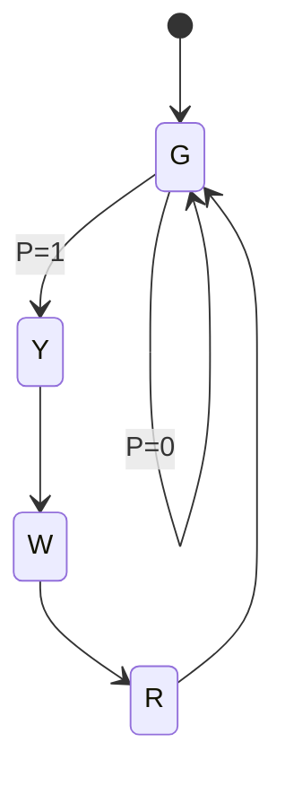

# A3 - FSM Design for Traffic Light Controller using GenAI
**Aim:** Use GenAI to generate the state diagram, state table and logic
equations for a traffic light FSM with a pedestrian request, implement it
with flip-flops and simulate it.

## Specification
- Input: P (pedestrian request)
- Outputs: Green, Yellow, Red, Walk
- Stays Green until P = 1, then Yellow -> Walk (cars see Red) -> Red -> Green

## State diagram

## State encoding (Gray code, one bit changes per transition)
| State | Q1 Q0 | Outputs |
|---|---|---|
| G (Green) | 00 | Green |
| Y (Yellow) | 01 | Yellow |
| W (Walk) | 11 | Red + Walk |
| R (Clearance) | 10 | Red |

## State table
| Q1 Q0 | P | D1 D0 (next state) |
|---|---|---|
| 00 | 0 | 00 |
| 00 | 1 | 01 |
| 01 | X | 11 |
| 11 | X | 10 |
| 10 | X | 00 |

## Equations
- D1 = Q0
- D0 = Q1' (P + Q0)
- Green = Q1' Q0', Yellow = Q1' Q0, Red = Q1, Walk = Q1 Q0

Check: G (00): D0 = P. Y (01): D0 = 1. W (11) and R (10): D0 = 0. D1 = Q0
gives 00->0, 01->1, 11->1, 10->0. Both columns match the table.

## Files
- `a3_traffic_fsm.v` - design, testbench and reference model
- `circuit/traffic_fsm.circ` - Logisim circuit
- `output.txt` - simulation log
- `prompts/prompts.md` - GenAI prompts and responses

## How to run
    iverilog -g2012 -o sim a3_traffic_fsm.v
    vvp sim

## Result
The sequence Green -> Yellow -> Walk -> Red -> Green repeats after each
request, and the testbench reports PASS against the reference model.

## Observations / edge cases
- P is read only in Green, so a press during Yellow, Walk or Red is ignored
  (tested by holding P = 1 through three states).
- Reset forces state 00 (Green) on power-up.
- All 4 codes are used, so there are no unused states.
- Gray code avoids glitches because only one flip-flop changes per transition.
- A press at the same moment as the clear-to-Green transition is not stored,
  so the pedestrian must press again. A latch on P would fix this.
- The clock here is one state per tick. A real controller would hold each
  state for N seconds using a slow counter-enable.
