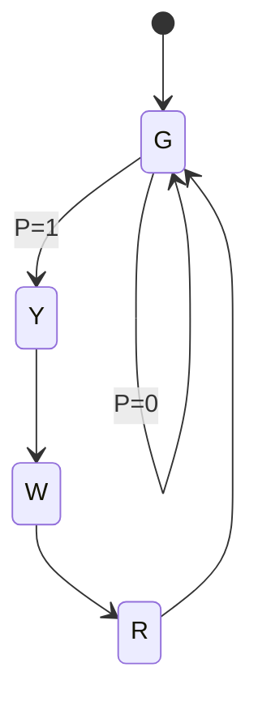

# A3 - FSM Design for Traffic Light Controller using GenAI
**Aim:** Use GenAI to develop and explain the state diagram, state table, and logic equations for a traffic light controller with a pedestrian request, and describe its implementation and expected operation using flip-flops.

## Specification
- Input: P (pedestrian request)
- Outputs: Green, Yellow, Red, Walk
- Stays Green until P = 1, then Yellow -> Walk (cars see Red) -> Red -> Green

## State diagram

## State encoding (Gray code, one bit changes per transition)
| State | Q1 Q0 | Outputs |
|---|---|---|
| G (Green) | 00 | Green |
| Y (Yellow) | 01 | Yellow |
| W (Walk) | 11 | Red + Walk |
| R (Clearance) | 10 | Red |

## State table
| Q1 Q0 | P | D1 D0 (next state) |
|---|---|---|
| 00 | 0 | 00 |
| 00 | 1 | 01 |
| 01 | X | 11 |
| 11 | X | 10 |
| 10 | X | 00 |

## Equations
- D1 = Q0
- D0 = Q1' (P + Q0)
- Green = Q1' Q0', Yellow = Q1' Q0, Red = Q1, Walk = Q1 Q0

Check: G (00): D0 = P. Y (01): D0 = 1. W (11) and R (10): D0 = 0. D1 = Q0
gives 00->0, 01->1, 11->1, 10->0. Both columns match the table.

## Files
- `circuit/` – Contains the circuit image or design, discussion, verification details, and truth table, as applicable to the assignment.
- `prompts/` – Contains the GenAI prompt and response log, including the prompts used, AI-generated responses, and verification or review of the results.

## Result
The FSM design defines the sequence Green -> Yellow -> Walk -> Red -> Green following a pedestrian request. The state transitions, output conditions, and logic equations are consistent with the specified traffic light behavior.

## Observations / Edge Cases
- The pedestrian request is checked only in the Green state. A request during Yellow, Walk, or Red is ignored.
- The controller starts in the Green state after reset.
- All four states have unique state assignments.
- Gray code encoding ensures that only one flip-flop changes during each normal state transition.
- A request at the same moment as the transition from Red to Green is not stored. A latch on the pedestrian request input would be needed to retain it.
- Each state represents one clock cycle. A practical controller would use a timing mechanism to hold each state for the required duration.

## GenAI Usage

**GenAI Tool Used:** Claude Sonnet 5.5, a large language model developed by Anthropic, accessed through the Claude.ai chat interface.

Generative AI was used to assist with:

- Understanding and interpreting the assignment requirements.
- Developing the logical or circuit design approach.
- Deriving Boolean expressions and related logic.
- Preparing truth tables and design documentation.
- Identifying appropriate logic gates and components.
- Explaining circuit operation, verification, and edge cases.
- Reviewing the design for logical consistency.

The AI-generated suggestions and outputs were reviewed and checked against the assignment requirements. Final design decisions and verification were based on the expected circuit behavior.

