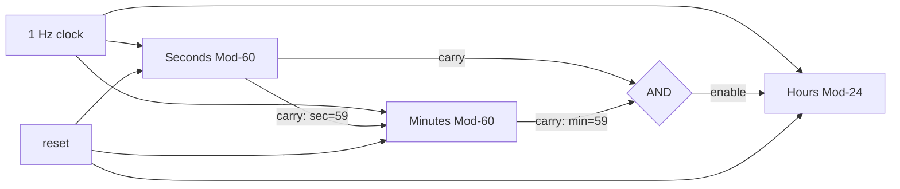

# A5 - Digital Clock FSM Design with GenAI
**Aim:** Use GenAI to derive the FSM states and flip-flop implementation of a
24-hour digital clock, then simulate and verify seconds, minutes and hours.

## Design
Three counters share one 1 Hz clock. Each counter is an FSM whose states are
its count values.

| Counter | Range | States | Flip-flops | Enabled when |
|---|---|---|---|---|
| Seconds | 0-59 (Mod-60) | 60 | 6 | always |
| Minutes | 0-59 (Mod-60) | 60 | 6 | sec = 59 |
| Hours | 0-23 (Mod-24) | 24 | 5 | sec = 59 and min = 59 |

Total: 17 flip-flops, 86,400 distinct clock states per day.

## Block diagram

## Next-state logic
- sec' = 0 if sec = 59, else sec + 1
- min' = min (hold) unless sec = 59: then 0 if min = 59, else min + 1
- hr' = hr (hold) unless sec = 59 and min = 59: then 0 if hr = 23, else hr + 1
- reset: all counters go to 00:00:00

## Rollover 23:59:59 -> 00:00:00
All three conditions are true at the same clock edge (sec = 59, min = 59,
hr = 23), so seconds, minutes and hours all wrap to 0 at once.

## Files
- `a5_digital_clock.v` - design + 24-hour testbench
- `circuit/digital_clock.circ` - Logisim circuit
- `output.txt` - testbench output
- `prompts/prompts.md` - GenAI prompts and responses

## How to run
    iverilog -g2012 -o sim a5_digital_clock.v
    vvp sim

## Result
All 86,400 ticks match the expected time, including the rollover.

## Observations / edge cases
- Rollover 23:59:59 -> 00:00:00 happens in a single edge.
- Reset while running returns the clock to 00:00:00.
- The values 24-31 in the hours counter and 60-63 in the minutes and seconds
  counters are unused. The counters never reach them from reset, but a
  power-up glitch could. Reset on power-up avoids that.
- The clock is divided down to 1 Hz from a faster crystal oscillator in a real
  clock. Here the clock input is treated as already 1 Hz.
